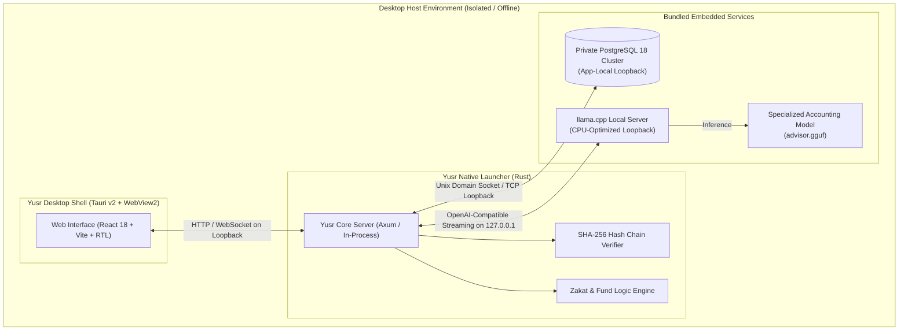

<p align="center">
  
</p>

<p align="center">
  
</p>

<h1 align="center">Yusr (يُسر)</h1>
<h3 align="center">Autonomous Fund Accounting & Back-Office Suite for Charities & Awqaf</h3>

<p align="center">
  <strong>100% Offline · Self-Contained Windows MSI · Embedded Local AI Advisor · Tamper-Evident SHA-256 Ledger · ZATCA Phase 2</strong>
</p>

<p align="center">
  <a href="LICENSE"></a>
  <a href="../../actions/workflows/desktop.yml"></a>
  <a href="../../actions/workflows/ci.yml"></a>
  
  
  
</p>

---

## 🌟 Executive Overview

**Yusr (يُسر)** is a modern, enterprise-grade back-office and fund accounting suite engineered specifically for non-profit organizations, charitable foundations, endowment funds (Awqaf), and Zakat committees.

Conventional accounting software treats all revenue uniformly. Charitable and endowment operations, however, are governed by strict legal, fiduciary, and Sharia conditions:
- **Zakat funds** can strictly be distributed only to the eight designated Quranic categories (*Asnaf*).
- **Endowment (Waqf) principal** is permanently held in perpetuity; only derived returns may be spent.
- **Designated donor gifts** must strictly remain bound to their declared projects.

**Yusr enforces these rules intrinsically at the engine level**, guaranteeing tamper-evident financial integrity with zero cloud dependency.

---

## 🚀 Key Architectural Highlights

### 1. Self-Contained Desktop Suite (MSI)
- Shipped as a unified, standalone **Windows Installer (MSI)** built with Tauri v2 and WiX.
- **No external prerequisites**: Bundles its own isolated PostgreSQL 18 server, native CPU model runtime (`llama-server`), the Yusr core engine, and frontend assets.
- **App-Local Deployment**: Zero system registry pollution and zero administrative interference. Drops rights cleanly via `pg_ctl`.

### 2. Autonomous Embedded AI Advisor (Offline Local LLM)
- **Zero Third-Party Middleware**: Does **not** require Ollama, LM Studio, Docker, or external Python interpreters.
- Powered by an embedded GGUF model managed directly by `yusr-launcher` on a local loopback port (`127.0.0.1`).
- **Domain-Trained in Charity Accounting**: Pre-instructed with non-profit fund accounting principles, double-entry verification, budget variance detection, and Zakat fiqh.
- **Read-Only by Construction**: The model only inspects sanitized system telemetry aggregates and insights. It cannot execute transactions or modify the database directly.

### 3. Fund Accounting by Construction
- Complete segregation across:
  - **Unrestricted General Funds** (الأصول غير المقيدة - التشغيلية).
  - **Temporarily Restricted Funds** (الأصول المقيدة زمنياً أو غرضياً - الإغاثة، كفالات الأيتام، المساجد).
  - **Permanently Restricted Endowments** (الأوقاف - حبس الأصل وتسبيل المنفعة).
- Posting engine guarantees that cross-subsidization and fund overdrawing are rejected at the transaction boundary.

### 4. Forensic SHA-256 Audit Trail
- Write-once ledger entries: Posted entries cannot be edited or deleted. Errors are corrected exclusively through complete, referenced reversing entries (*القيود العكسية*).
- Every transaction, user modification, and archive upload joins a cryptographically linked SHA-256 hash chain.
- Instant, one-click mathematical proof of database integrity (`/audit`).

### 5. ZATCA Phase 2 Ready (Saudi Electronic Invoicing)
- Cryptographic stamps, ECDSA secp256k1 / k256 digital signatures, UBL 2.1 XML compliance, and sequential invoice hashing.

---

## 📐 System Architecture



---

## 🛠 Feature Modules

| Module | Core Functionality |
| :--- | :--- |
| 📒 **Ledger & Funds** | Dual-entry fund accounting, hierarchical Chart of Accounts, manual entries with audit reversals, multi-currency with historical exchange rates, trial balance. |
| 💝 **Donations & Receipts** | Sequential gap-free receipts, Zakat deduction certificates, donor registries, integrated payment webhooks (Tap, Moyasar, Fawry). |
| 🕌 **Zakat Engine** | Nisab calculation based on live or pinned gold/silver rates, tradable goods evaluation, debt deduction, and strict restriction to the 8 Quranic categories. |
| 🤝 **Sponsorships** | Long-term orphan, family, student, and patient sponsorships; automated ledger reconciliation and arrears calculation. |
| 🏠 **Beneficiaries & Aid** | Multi-factor need assessment scoring, priority classification, single-use signed voucher verification system. |
| 🙋 **Volunteers** | Volunteer registry, skill tagging, service logs, and quantitative economic valuation of volunteer hours according to national non-profit standards. |
| 🗂️ **Encrypted Archive** | Numbered document filing, write-once files verified with SHA-256 checksums, confidentiality tiers (HR, Legal, Board, Financial). |
| ✉️ **Letters & Correspondence**| Hijri-calendar numbered official correspondence, dynamic letterhead, digital stamps, automated PDF/Word export. |
| 📊 **Financial Reporting** | A4 formatted Statements of Financial Position, Statement of Activities, Cash Flows, Budget vs. Actual variance, exportable to PDF, Excel, and Word. |
| 🤖 **AI Advisor** | In-app contextual advisor with anomaly alerts, budget threshold tracking (>90%), and natural language accounting query assistance. |
| 🔐 **Granular Access Control** | 41 granular permissions across administrative roles, instantly verifiable at runtime. |
| 💾 **Deterministic Backups** | Atomic database snapshots, table-by-table SHA-256 verification, and byte-for-byte verified restore prior to commit. |

---

## 🖥 User Interface & Layout Precision

The interface is tailored for intensive daily accounting work:
- **Ergonomic Sidebar**: Sized to hug the navigation items cleanly, with zero dead space, terminating exactly **1 cm** below the Settings navigation item.
- **Native Dual-Language Support**: Seamless right-to-left (Arabic) and left-to-right (English) typography with `IBM Plex Sans Arabic`.
- **Keyboard Shortcuts**: Instant navigation via standard shortcuts (press `?` anywhere in the app).

---

## 🧠 Local Model Accounting Fine-Tuning Pipeline

The repository includes a dedicated training pipeline in `training/`:
- **`accounting_dataset.jsonl`**: Specialized non-profit accounting dataset covering fund segregation, Zakat rules, double-entry entries, and ZATCA compliance.
- **`finetune_lora.py`**: QLoRA training script using Hugging Face `transformers` and `peft`.
- **`convert_and_quantize.sh`**: Automated pipeline to convert trained LoRA adapters to GGUF format (`Q4_K_M`) for packaging into `app/resources/models/advisor.gguf`.

---

## 📦 Building the Self-Contained Windows MSI

The self-contained MSI installer bundles everything required to run Yusr without internet access.

### Automated GitHub Actions CI/CD (With Resumable Builds)
The repository features an automated GitHub Actions workflow (`.github/workflows/desktop.yml`) with:
- **Resumable Downloads**: Uses `curl.exe -C -` to resume partial downloads of large assets (PostgreSQL binaries, llama-server, and GGUF model) from where they stopped.
- **Multi-Tier Cache & Fallback**: `cache-on-failure: true` ensures that intermediate compiler artifacts and downloaded binaries are preserved across runs.

### Manual Local Packaging (Windows)
```powershell
# 1. Build the web interface
cd web
npm ci
npm run build
cd ..

# 2. Fetch all bundled runtime binaries (resumable)
./app/scripts/fetch-resources.ps1

# 3. Test launcher and run smoke tests
cargo run --release -p yusr-launcher --example smoke -- app/resources

# 4. Generate the Windows MSI installer (with boot autostart)
cd app
npx --yes @tauri-apps/cli@2.12.4 build --bundles msi
```
The generated MSI will be placed in `app/src-tauri/target/release/bundle/msi/`.

---

## 🚀 Installation Packages & Automated Boot Services (حزم التثبيت والتشغيل التلقائي)

All distribution packages and setup scripts provide out-of-the-box database lifecycle management:

1. **Automatic Database Installation**: Automatically provisions or bundles PostgreSQL.
2. **Database & Role Provisioning**: Creates user `yusr` and isolated database `yusr` with UTF-8 encoding.
3. **Verified Connection**: Auto-generates `DATABASE_URL` and validates connection readiness before service start.
4. **Boot Autostart**: Configures and enables system-level services so both the database and Yusr run automatically upon machine startup.

### 🐧 Linux Server / Desktop All-In-One Setup
Run the unified installer as root to install PostgreSQL, configure the database, and enable systemd auto-start on boot:
```bash
sudo bash tools/install.sh
```

### 📦 Debian / Ubuntu Package (.deb)
Build and install the `.deb` package with full PostgreSQL dependencies and systemd lifecycle hooks:
```bash
# Build deb bundle
cd app
npx --yes @tauri-apps/cli@2.12.4 build --bundles deb

# Install deb package
sudo dpkg -i src-tauri/target/release/bundle/deb/*.deb
```

### 🪟 Windows Boot Autostart & Service Setup
Configure PostgreSQL cluster and register boot startup via PowerShell:
```powershell
powershell -ExecutionPolicy Bypass -File ./tools/install-autostart.ps1
```

---

## 📜 Intellectual Property, Patent & Non-Commercial License

Copyright © 2025–2026 **ZeidexSoft / Zeiad** (<https://zeidexsoft.com>). All rights reserved.

### ⚖️ License Summary
This software is licensed under the **PolyForm Noncommercial License 1.0.0** with explicit Patent Grant and Patent Defense terms:
1. **Permitted Use**: You are free to inspect, run, modify, and utilize this software for **strictly non-commercial, personal, educational, religious, and charitable non-profit purposes**.
2. **Commercial Restriction**: Any commercial use—including but not limited to selling, renting, licensing, offering as a paid cloud/SaaS service, or embedding within commercial proprietary products—**IS STRICTLY FORBIDDEN without prior written permission from the developer**.
3. **Patent Defense**: Licensors grant a non-commercial patent license. Any written patent infringement claim asserted against this software immediately terminates all granted licenses.

For commercial licensing inquiries, contact: **`info@zeidexsoft.com`**

---

<p align="center">
  Crafted with precision for the non-profit and charitable sector · <strong>ZeidexSoft</strong>
</p>
